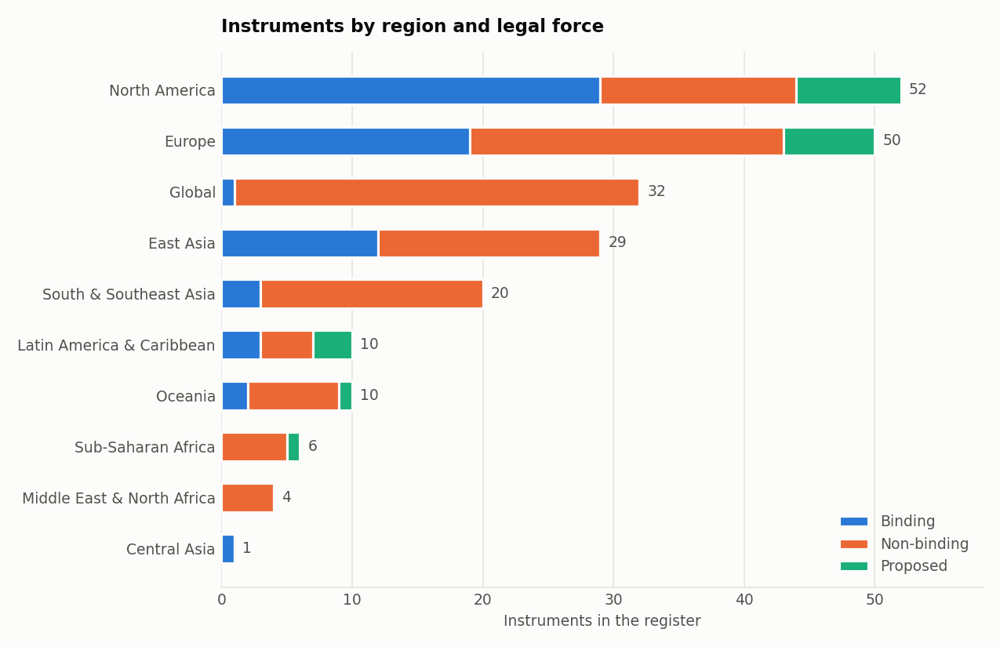

# AI Safety Policy Register: analysis example

Snapshot 2026-10-11, version 1.2, 214 records. Generated by `examples/analysis.py` from `data/register.sqlite`.

## 1. Headline figures

| Measure | Value |
|---|---:|
| Records | 214 |
| Binding | 70 |
| Non-binding | 124 |
| Proposed | 20 |
| Countries with national or sub-national instruments | 40 |
| Distinct jurisdictions and bodies | 68 |

## 2. Instruments per year of publication, by legal force

Year = first four characters of `date_published`, so partial dates count too. 5 records have no date and are left out.

| Year | Binding | Non-binding | Proposed | Total |
|---|---:|---:|---:|---:|
| 2017 | 0 | 1 | 0 | 1 |
| 2019 | 2 | 1 | 0 | 3 |
| 2020 | 0 | 2 | 0 | 2 |
| 2021 | 1 | 1 | 0 | 2 |
| 2022 | 1 | 2 | 2 | 5 |
| 2023 | 6 | 19 | 1 | 26 |
| 2024 | 16 | 36 | 4 | 56 |
| 2025 | 27 | 39 | 4 | 70 |
| 2026 | 17 | 18 | 9 | 44 |

## 3. Regions

| Region | Records | Binding | Non-binding | Proposed | Binding share |
|---|---:|---:|---:|---:|---:|
| North America | 52 | 29 | 15 | 8 | 56% |
| Europe | 50 | 19 | 24 | 7 | 38% |
| Global | 32 | 1 | 31 | 0 | 3% |
| East Asia | 29 | 12 | 17 | 0 | 41% |
| South & Southeast Asia | 20 | 3 | 17 | 0 | 15% |
| Oceania | 10 | 2 | 7 | 1 | 20% |
| Latin America & Caribbean | 10 | 3 | 4 | 3 | 30% |
| Sub-Saharan Africa | 6 | 0 | 5 | 1 | 0% |
| Middle East & North Africa | 4 | 0 | 4 | 0 | 0% |
| Central Asia | 1 | 1 | 0 | 0 | 100% |

## 4. Safety topics, by legal force

A record can carry several topics, so columns do not sum to the record count.

| Topic | Records | Binding | Non-binding | Proposed |
|---|---:|---:|---:|---:|
| accountability & liability | 124 | 47 | 62 | 15 |
| evaluation & testing | 103 | 27 | 69 | 7 |
| transparency & labelling | 99 | 38 | 50 | 11 |
| general-purpose / frontier AI | 75 | 17 | 47 | 11 |
| human oversight | 63 | 18 | 41 | 4 |
| international cooperation | 59 | 5 | 53 | 1 |
| risk-based classification | 53 | 21 | 24 | 8 |
| deepfakes & synthetic media | 43 | 18 | 21 | 4 |
| public-sector use | 41 | 19 | 21 | 1 |
| catastrophic risk | 35 | 6 | 24 | 5 |
| safety institute | 32 | 6 | 23 | 3 |
| incident reporting | 25 | 4 | 13 | 8 |
| national security & military | 25 | 6 | 18 | 1 |
| child safety | 23 | 15 | 7 | 1 |
| prohibited practices | 23 | 13 | 4 | 6 |
| research priorities | 23 | 3 | 20 | 0 |
| critical infrastructure | 11 | 5 | 5 | 1 |

## 5. Topic pairs that most often appear in the same instrument

| Topic A | Topic B | Records |
|---|---|---:|
| accountability & liability | transparency & labelling | 75 |
| evaluation & testing | general-purpose / frontier AI | 52 |
| accountability & liability | human oversight | 50 |
| accountability & liability | evaluation & testing | 46 |
| human oversight | transparency & labelling | 40 |
| accountability & liability | risk-based classification | 37 |
| catastrophic risk | general-purpose / frontier AI | 34 |
| evaluation & testing | transparency & labelling | 34 |
| catastrophic risk | evaluation & testing | 32 |
| accountability & liability | public-sector use | 31 |

## 6. Time from publication to entry into force (binding instruments)

Only records with a full `date_published` and `date_in_force` are counted. Negative values are instruments that took effect before formal publication; large values are phased laws whose first obligations apply much later.

| Measure | Days |
|---|---:|
| Instruments with both dates | 56 |
| Minimum | -2 |
| Lower quartile | 0 |
| Median | 11 |
| Upper quartile | 80 |
| Maximum | 510 |

Shortest three and longest three:

| ID | Instrument | Published | In force | Days |
|---|---|---|---|---:|
| US-10 | AI Diffusion Rule | 2025-01-15 | 2025-01-13 | -2 |
| EU-09 | AI Act standardisation request to CEN-CENELEC | 2025-06-23 | 2025-06-23 | 0 |
| AUS-01 | Australia APS responsible AI policy | 2024-09-01 | 2024-09-01 | 0 |
| KR-02 | Korea AI Basic Act | 2025-01-21 | 2026-01-22 | 366 |
| US-NY-01 | New York RAISE Act | 2025-12-19 | 2027-01-01 | 378 |
| US-IL-01 | Illinois HB 3773 (AI in employment) | 2024-08-09 | 2026-01-01 | 510 |

## 7. Evidence behind the records

| Verification level | Records |
|---|---:|
| A | 198 |
| B | 13 |
| C | 3 |

| Local copy status | Records |
|---|---:|
| archived | 175 |
| archived-review | 16 |
| partial | 12 |
| failed | 11 |

Records with at least one locally stored PDF: 113 of 214.
