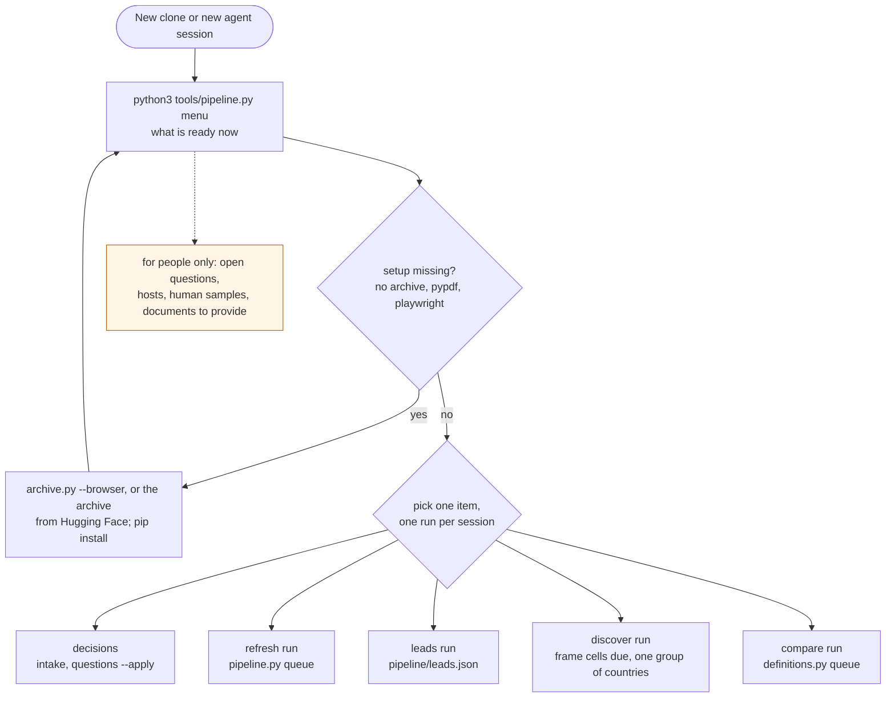
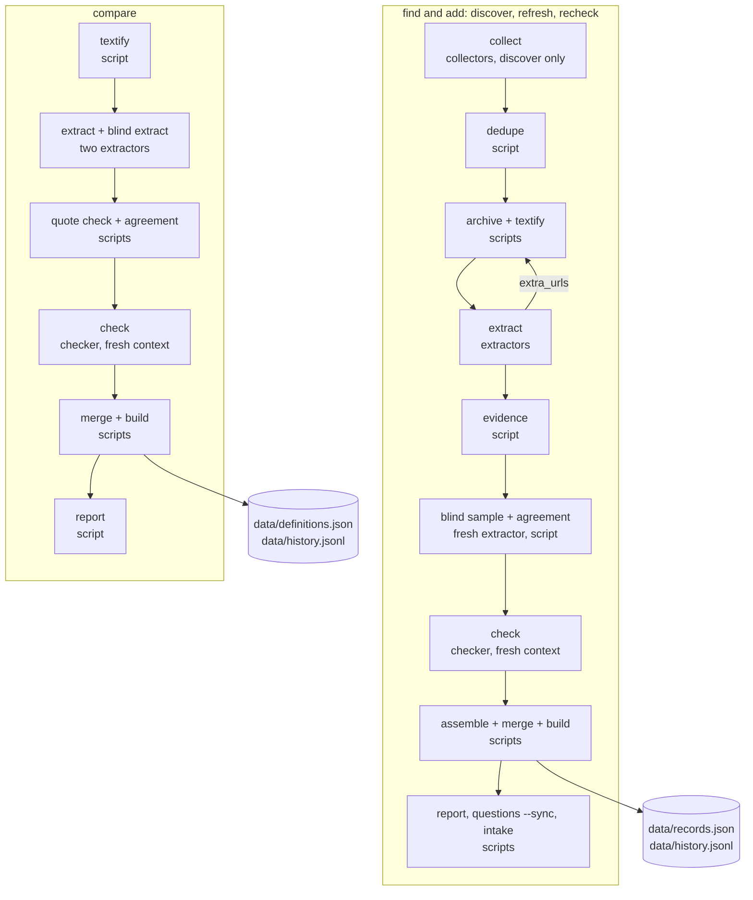
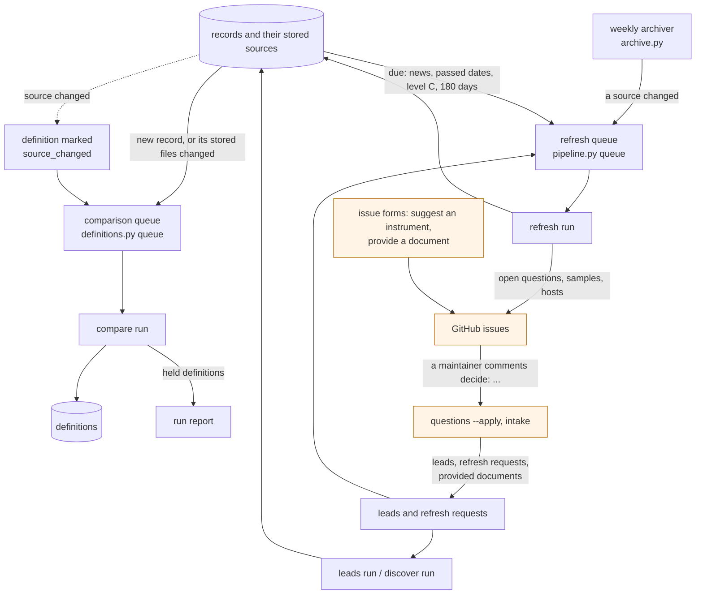
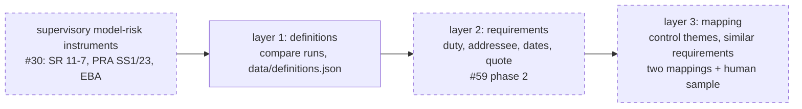

# How the pipeline fits together

These charts show what an agent session can do, what each run kicks off, and how the runs feed each other. Solid boxes exist today. Dashed boxes are planned and tracked in the issues named in them. AGENTS.md is the contract; when a chart and AGENTS.md disagree, AGENTS.md is right and the chart needs fixing.

## 1. Where a session starts

Every run is created with `pipeline.py new`. It refuses a run larger than 120 frame cells or 40 records (15 for compare) unless a person adds `--large`. It writes the run's steps into `run.json` and prints them, and `pipeline.py status` ticks them off.

## 2. What a run kicks off

Refresh and recheck runs start at "archive + textify": their candidates are the records. A compare run never changes a record, and a find-and-add run never writes `data/definitions.json`. Each run ends with one commit on `run/<run-id>`, which a person reviews and merges.

## 3. How the runs feed each other

## 4. The crosswalk (issue #70)

The tracker at the top of issue #70 lists what is done, what is next and what is parked.
